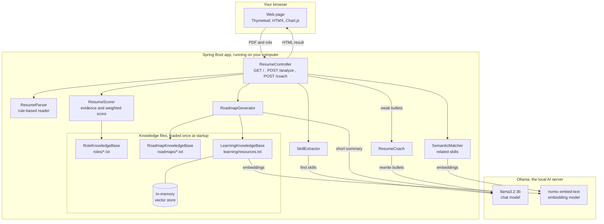
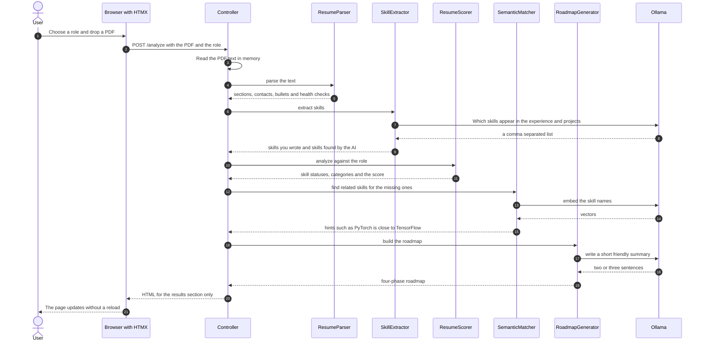
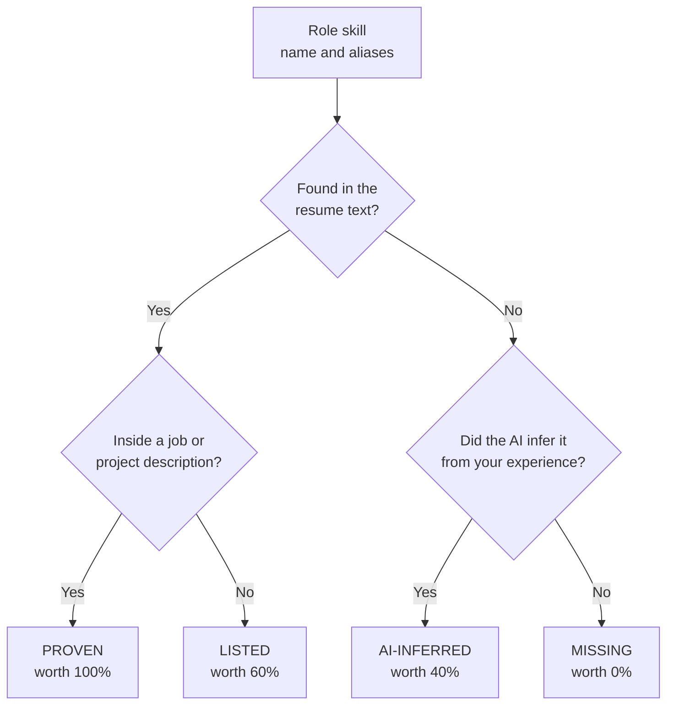
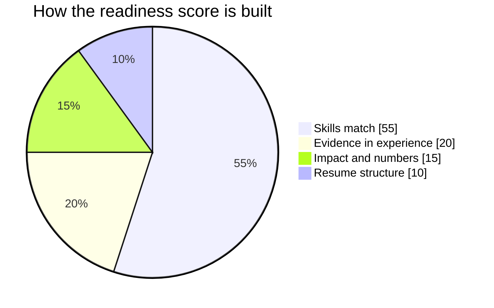
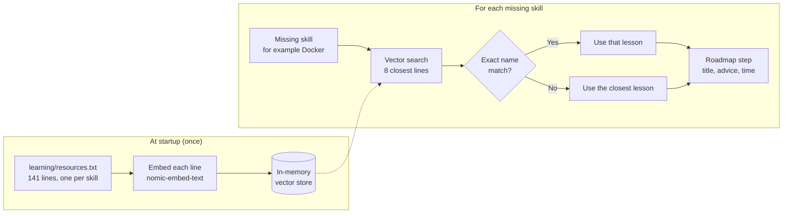
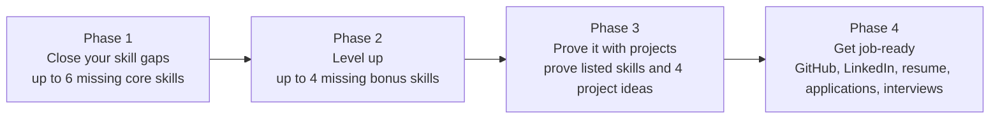
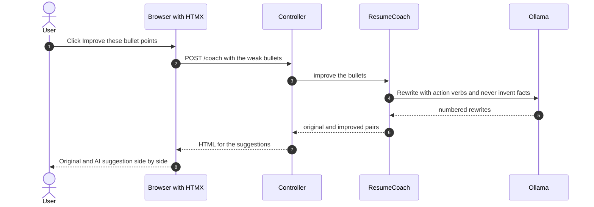
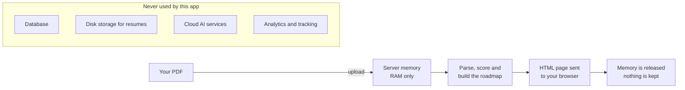
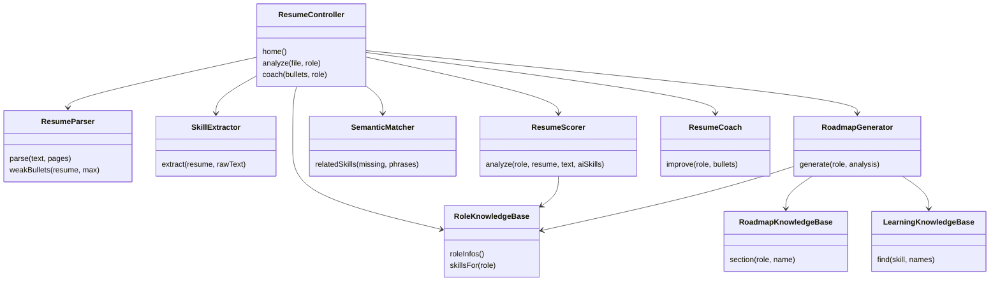

# AI Resume Analyzer

### Know exactly how ready your resume is for the job you want, and get a plan to close the gap.

A **privacy-first** web app that reads a PDF resume, compares it with **10 modern tech roles**,
and gives you an **evidence-based score**, a **skill matrix**, a **personalized learning roadmap**
and **AI feedback on your weakest bullet points**.
Everything runs on **your own computer** with a local AI model. Your resume is never stored or sent anywhere.


[What is it?](#what-is-this-project) &nbsp;|&nbsp;
[Features](#features) &nbsp;|&nbsp;
[Architecture](#how-it-works) &nbsp;|&nbsp;
[Get started](#getting-started) &nbsp;|&nbsp;
[Glossary](#glossary) &nbsp;|&nbsp;
[Author](#author)

---

## At a glance

| | |
|---|---|
| **What it does** | Reads a PDF resume and tells you how ready you are for a chosen tech role, with proof for every skill |
| **Who it is for** | Students, freshers and career switchers who want clear, honest, actionable resume feedback |
| **What makes it different** | The score is built from **evidence** (a skill used in a real project counts more than a skill in a list). The AI never invents your score or your learning resources. |
| **Privacy** | 100% local. No database, no cloud AI, no tracking. Your resume lives in memory for a few seconds and is then discarded. |

## Table of contents

1. [What is this project?](#what-is-this-project)
2. [See it in action](#see-it-in-action)
3. [Features](#features)
4. [The 10 target roles](#the-10-target-roles)
5. [How to use the app](#how-to-use-the-app)
6. [How it works](#how-it-works)
7. [Technology stack](#technology-stack)
8. [Project structure](#project-structure)
9. [Getting started](#getting-started)
10. [Configuration](#configuration)
11. [HTTP endpoints](#http-endpoints)
12. [Extend it: add roles, skills and resources](#extend-it-add-roles-skills-and-resources)
13. [Design decisions and lessons learned](#design-decisions-and-lessons-learned)
14. [Quality and testing](#quality-and-testing)
15. [Security and privacy](#security-and-privacy)
16. [Limitations](#limitations)
17. [Troubleshooting](#troubleshooting)
18. [How this project was built](#how-this-project-was-built)
19. [Future ideas](#future-ideas)
20. [Glossary](#glossary)
21. [FAQ](#faq)
22. [Acknowledgements and licenses](#acknowledgements-and-licenses)
23. [Author](#author)

---

## What is this project?

### In plain English

Imagine you want to become an **ML Engineer** and you have a resume. How do you know if it is good enough?
Most online tools just count keywords and give you a number you cannot trust or understand.

**AI Resume Analyzer** works like a careful mentor:

1. You pick the job you want (for example *Generative AI Engineer*).
2. You upload your resume as a PDF.
3. The app reads it, understands its sections, and checks **every skill that role needs**.
4. For each skill it tells you whether you **proved** it in a real job or project, **only listed** it, or are **missing** it.
5. It gives you a **score you can explain**, a **step-by-step learning plan**, and **better wording** for your weakest bullet points.

### Why it exists

| Problem with typical resume tools | How this project solves it |
|---|---|
| A single mysterious score | Four clearly explained score parts with weights |
| Keyword stuffing is rewarded | A skill with **proof** in a project counts more than a skill in a list |
| Your private resume is uploaded to a website | Everything runs **on your computer**, nothing is stored |
| AI tools invent courses and links | Learning resources come from **curated files**. The AI only writes a short summary. |
| Generic advice | Advice depends on the role you chose and the gaps we actually found |

### Who it is for

- Students and freshers preparing for AI, software, data, cloud or security roles
- Career switchers who want to know what to learn first
- Developers who want a real example of **local AI**, **RAG**, **Spring AI** and **HTMX** working together

---

## See it in action

> [!TIP]
> Create a **sample resume with fake details** for screenshots and videos, so your real personal information is never shown.

Add your screenshots to a `docs/` folder and they will appear here:

```markdown


```

**Demo video:** add your YouTube link here after recording.

### Try it in 2 minutes

1. Start the app (see [Getting started](#getting-started)) and open <http://localhost:8080>.
2. Choose a role card, for example **ML Engineer**.
3. Drop in a PDF resume and click **Analyze my resume**.
4. Wait about one to three minutes (the AI runs on your laptop). Then open each tab.

---

## Features

### Analysis

| Feature | What it gives you |
|---|---|
| **Evidence-based score** | Every role skill is *proven*, *listed*, *AI-inferred* or *missing*, then combined into a weighted readiness score |
| **Skill matrix** | All role skills grouped by area, with where each one was found in your resume |
| **Radar chart** | Your coverage in each area (for example *Deep Learning*, *RAG and Data*) at a glance |
| **Related-skill hints** | Spots skills you already know that are close to a missing one (for example PyTorch and TensorFlow) |
| **Resume health check** | 10 rule-based checks: contact links, summary, sections, numbers in bullets, length |
| **Resume breakdown** | Your PDF is split into profile, skills, experience, projects and education, so you can see how a computer reads it |

### Guidance

| Feature | What it gives you |
|---|---|
| **4-phase roadmap** | Close gaps, level up, prove it with projects, get job-ready, each step with a time estimate |
| **RAG learning resources** | A vector database finds the best free resource for every missing skill |
| **AI resume coach** | Rewrites bullet points that have no numbers, using placeholders such as `[X%]` instead of invented facts |
| **Progress tracker** | Tick off roadmap steps and watch the progress bar (kept only on the page, never saved) |

### Experience

| Feature | What it gives you |
|---|---|
| **10 role cards** | Pick your goal with one click |
| **Drag and drop upload** | Drop a PDF anywhere on the upload box |
| **No page reloads** | HTMX updates only the results part of the page |
| **Dark mode** | One button, remembers your choice |
| **Print or save as PDF** | Take your roadmap with you |
| **Works offline** | All libraries are bundled. No CDN, no tracking, no external requests |

---

## The 10 target roles

The app currently knows **227 role-skill checks** across 10 roles. Each role has *core* skills (must have, count double) and *bonus* skills (nice to have).

| # | Role | Focus | Skills |
|---|---|---|---|
| 1 | 🤖 **ML Engineer** | Train, evaluate and ship machine learning models | 25 |
| 2 | ☕ **Java Developer** | Secure, scalable backends with Java and Spring | 26 |
| 3 | 📊 **Data Analyst** | Turn raw data into insights, dashboards and decisions | 22 |
| 4 | ✨ **Generative AI Engineer** | LLM apps with RAG, fine-tuning and guardrails | 21 |
| 5 | 🧠 **AI Agent Engineer** | Agents that plan, use tools and work together | 24 |
| 6 | ⚙️ **MLOps Engineer** | Automate, deploy and monitor ML systems | 21 |
| 7 | 👁️ **Computer Vision Engineer** | Detection, tracking and edge AI | 22 |
| 8 | 🛡️ **AI Security Engineer** | Protect systems and AI models from modern attacks | 21 |
| 9 | ☁️ **Cloud DevOps Engineer** | Infrastructure as code, pipelines and reliability | 21 |
| 10 | 🌐 **Full-Stack AI Developer** | Complete web apps with AI features | 24 |

Every role also has **4 project ideas** (beginner to advanced), **5 career steps**, and learning resources for all **141 distinct skills**.

---

## How to use the app

1. **Choose a role.** Click one of the 10 cards.
2. **Upload a PDF.** Drop it on the box or click to browse (PDF only, up to 5 MB).
3. **Click Analyze.** A loading screen shows while the local AI works.
4. **Explore the six tabs:**

| Tab | What you will see |
|---|---|
| **Overview** | Score ring, radar chart, the four score parts, your proven skills, what to learn first, health check |
| **Skill matrix** | Every skill with a status pill and the proof we found. Use the filters: *All, Missing, Proven, Listed or inferred* |
| **Roadmap** | Four phases with time badges. Tick steps to track progress. Print or save as PDF. |
| **AI coach** | Your weakest bullet points. Click the button to get rewrites (about a minute). |
| **Resume breakdown** | How your resume was structured: profile, skills by category, experience, projects, education |
| **Under the hood** | The skills the app detected (yours in green, AI-found in blue) and the raw extracted text |

---

## How it works

### In plain English

1. **Read.** The PDF text is extracted in memory.
2. **Understand.** Simple rules split the text into sections (summary, skills, experience, projects, education) and find your contact links. A small local AI model then reads your experience and projects and lists the skills it finds.
3. **Match.** Every skill the chosen role needs is checked using the skill name and its aliases (for example *scikit-learn* and *sklearn*). Each skill gets a status based on **where** it was found.
4. **Score.** Statuses, evidence, numbers in your bullets and resume structure are combined into one readiness score.
5. **Guide.** A vector database finds the best learning resource for each gap. The AI writes a short friendly summary. The coach rewrites weak bullets on request.

The sections below show each part as a diagram.

### The big picture

Everything runs on one computer: the browser, the Spring Boot app and the Ollama AI server.



### The journey of one resume

What happens between clicking **Analyze** and seeing your results.



### How every skill gets its status

This is the heart of the project. A skill used in real work is stronger evidence than a skill in a list.



| Status | Meaning | Worth |
|---|---|---|
| **Proven** | Found inside an experience or project description | 100% |
| **Listed** | Found in the resume, but only in a skills list or summary | 60% |
| **AI-inferred** | Not written in the text, but the AI spotted it in your work | 40% |
| **Missing** | No evidence at all | 0% |

Matching uses whole words, so `java` never matches `JavaScript` and `sql` never matches `MySQL`.

### How the score is built



| Part | Weight | How it is calculated |
|---|---|---|
| **Skills match** | 55% | Weighted average of skill worth. Core skills count **double**. |
| **Evidence in experience** | 20% | Share of matched skills that are *proven* (not only listed) |
| **Impact and numbers** | 15% | Share of experience and project bullets that contain a number. Full marks at 60% or more. |
| **Resume structure** | 10% | Share of the 10 health checks that pass |

**Verdict:** 85 or more is *Excellent*, 70 to 84 *Strong*, 50 to 69 *Fair, with some gaps*, below 50 *Needs work*.

<details>
<summary><b>Worked example (click to open)</b></summary>

A tiny role with 4 skills: core A, core B, core C and bonus D. Your resume has 5 bullets (3 with numbers), and 8 of 10 health checks pass.

| Skill | Type | Status | Weight | Points earned |
|---|---|---|---|---|
| A | core | proven | 2 | 2 x 1.0 = 2.0 |
| B | core | listed | 2 | 2 x 0.6 = 1.2 |
| C | core | missing | 2 | 2 x 0.0 = 0.0 |
| D | bonus | AI-inferred | 1 | 1 x 0.4 = 0.4 |
| | | | **7** | **3.6** |

- Skills match = 3.6 / 7 = **51%**
- Evidence = 1 proven out of 2 matched = **50%**
- Impact = 3 of 5 bullets = 60%, which gives full marks = **100%**
- Structure = 8 of 10 checks = **80%**

Readiness = 0.55 x 51 + 0.20 x 50 + 0.15 x 100 + 0.10 x 80 = **61%**, a *Fair match*.

</details>

### How the roadmap is built (RAG)

**RAG** means *Retrieval-Augmented Generation*: first **retrieve** trusted facts, then let the AI write around them.
Here the AI does **not** choose courses. They come from a curated file, found with a vector search.



The roadmap has four phases:



- Phases 1 and 2 use the vector search above. If the embedding model finds a related skill you already have, the step says so ("You already know PyTorch, so this should go faster").
- Phase 3 starts with a **"Prove the skills you list"** step for skills that appear in your resume without a project behind them.
- The AI only writes the short summary at the top. It cannot invent a course, a book or a link.

### The AI resume coach

The coach runs **only when you ask**, so the main analysis stays fast. Nothing is stored on the server between requests.



> [!IMPORTANT]
> The coach is told never to invent numbers, tools or facts. Where a number would help it writes a placeholder like `[X%]`. Replace placeholders with **your real numbers** and never add anything that is not true.

### Where your data goes



### How the code is organized



| Class | Responsibility |
|---|---|
| `ResumeController` | Web endpoints. Runs the pipeline in order and sends back the page or only the results part. |
| `ResumeParser` | Rule-based reader: name, contacts, sections, skills by category, jobs with dates, bullets, health checks, weak bullets |
| `SkillExtractor` | Skills **you wrote** (rules) and skills **found by the AI** in your experience and projects, kept apart |
| `ResumeScorer` | Statuses, evidence, categories and the weighted score |
| `SemanticMatcher` | Related-skill hints from embeddings. Hints never change the score. |
| `RoleKnowledgeBase` | Loads the 10 role files (categories, core and bonus skills, aliases, icon, tagline) |
| `RoadmapKnowledgeBase` | Loads project ideas and career steps for each role |
| `LearningKnowledgeBase` | The RAG store: embeddings, vector search and exact-name re-ranking |
| `RoadmapGenerator` | Builds the four phases, time estimates and the short AI summary |
| `ResumeCoach` | Rewrites weak bullets without inventing facts |

---

## Technology stack

| Technology | Used for | Why this choice |
|---|---|---|
| **Java 25** (runs on 21 or newer) | Language | Strong typing, records for clean data, a skill employers value |
| **Spring Boot 4.1** | Web application | Industry-standard Java framework |
| **Spring AI 2.0** | Talks to the AI models | One clean API for chat, embeddings and the vector store |
| **Ollama** | Runs AI models locally | Free, private, works offline |
| **Llama 3.2 (3B)** | Chat model | Small enough for a laptop |
| **nomic-embed-text** | Embedding model | Small (about 274 MB), good for semantic search |
| **SimpleVectorStore** | Vector database | In memory only, which fits the "store nothing" promise |
| **Apache PDFBox 3** | Reads PDF text | Mature, free and Java-native |
| **Thymeleaf** | HTML templates | Server-side pages with fragments |
| **HTMX 2** | Partial page updates | A modern, trending alternative to a heavy JavaScript framework |
| **Chart.js 4** | Radar chart | Simple, light and popular |
| **Plain CSS** | Design | CSS variables give light and dark themes with no build step |

HTMX and Chart.js are **bundled** in `static/vendor/`, so the app makes no external requests.

---

## Project structure

```
resume-analyzer/
├── pom.xml                         Maven build file
├── mvnw, mvnw.cmd                  Maven wrapper (no Maven install needed)
├── README.md
├── LICENSE
├── .gitignore                      also blocks *.pdf and secrets
└── src/main/
    ├── java/com/resumeai/resumeanalyzer/
    │   ├── ResumeanalyzerApplication.java    application entry point
    │   ├── ResumeController.java             web endpoints
    │   ├── ResumeParser.java                 rule-based resume reader
    │   ├── SkillExtractor.java               your skills plus AI-found skills
    │   ├── ResumeScorer.java                 evidence statuses and score
    │   ├── SemanticMatcher.java              related-skill hints
    │   ├── RoleKnowledgeBase.java            loads roles/
    │   ├── RoadmapKnowledgeBase.java         loads roadmaps/
    │   ├── LearningKnowledgeBase.java        RAG vector store
    │   ├── RoadmapGenerator.java             four-phase roadmap
    │   └── ResumeCoach.java                  AI bullet rewrites
    └── resources/
        ├── application.properties            settings
        ├── roles/                            10 files: skills per role
        ├── roadmaps/                         10 files: projects and career steps
        ├── learning/resources.txt            141 learning resources (the RAG data)
        ├── templates/index.html              the page (Thymeleaf and HTMX)
        └── static/
            ├── style.css                     design, dark mode, print styles
            ├── app.js                        tabs, charts, upload box, loading screen
            └── vendor/                       htmx.min.js and chart.umd.min.js
```

---

## Getting started

### What you need

| Requirement | Details |
|---|---|
| **JDK 21 or newer** | Check with `java -version` |
| **Ollama** | Download from <https://ollama.com> |
| **Git** | To clone the project |
| **Memory** | About 8 GB RAM is comfortable. The two models need roughly 2.3 GB of disk space. |

### 1. Download the AI models (once)

```bash
ollama pull llama3.2:3b
ollama pull nomic-embed-text
```

### 2. Get the project

```bash
git clone https://github.com/MAHAMMAD-SAKHB-SPACE786/resume-analyzer.git
cd resume-analyzer
```

### 3. Run it (keep Ollama running)

```bash
# Windows (PowerShell)
.\mvnw.cmd spring-boot:run

# Mac or Linux
./mvnw spring-boot:run
```

The first start takes a little longer because it downloads libraries and embeds the 141 learning resources.
Wait for the line `Started ResumeanalyzerApplication`.

### 4. Open the app

Go to <http://localhost:8080>, choose a role, upload a PDF and click **Analyze my resume**.
An analysis usually takes one to three minutes on a laptop.

> [!NOTE]
> If the page looks outdated after an update, press `Ctrl + F5` to clear the cached files.

---

## Configuration

All settings live in `src/main/resources/application.properties`:

```properties
# Where Ollama runs and which models to use
spring.ai.ollama.base-url=http://localhost:11434
spring.ai.ollama.chat.options.model=llama3.2:3b
spring.ai.ollama.chat.options.temperature=0.2
spring.ai.ollama.embedding.options.model=nomic-embed-text

# Upload limits. The threshold keeps small files in memory instead of on disk.
spring.servlet.multipart.max-file-size=5MB
spring.servlet.multipart.max-request-size=5MB
spring.servlet.multipart.file-size-threshold=5MB

# How close in meaning two skills must be to show a related-skill hint (0 to 1).
# Higher means fewer, stricter hints.
app.semantic.threshold=0.72
```

| Setting | What it does |
|---|---|
| `spring.ai.ollama.chat.options.model` | The chat model. A smaller model is faster, a larger one is usually more accurate. |
| `temperature` | Lower means more focused and repeatable answers |
| `app.semantic.threshold` | Controls the related-skill hints. They never change the score. |
| `server.port` | Add `server.port=8081` if port 8080 is already used |

---

## HTTP endpoints

| Method | Path | Purpose |
|---|---|---|
| `GET` | `/` | The home page with the 10 role cards |
| `POST` | `/analyze` | Form fields `resume` (PDF) and `role`. Returns the full page, or only the results section when the request comes from HTMX (header `HX-Request`). |
| `POST` | `/coach` | Fields `bullets` (one per line) and `role`. Returns the AI suggestions as an HTML fragment. |

---

## Extend it: add roles, skills and resources

You can add a new role **with text files only, no Java changes**.

### 1. Create the role file `src/main/resources/roles/<name>.txt`

```
Data Engineer
@icon 🗄️
@tagline Build reliable pipelines that move and prepare data
@order 11
[Foundations]
Python|python3
SQL|sql
Git|git|github
[Pipelines]
ETL|etl|data pipeline|airflow
+Kafka|kafka|rabbitmq
```

| Line | Meaning |
|---|---|
| First line | The role name |
| `@icon`, `@tagline`, `@order` | Role card details and position |
| `[Category]` | Starts a group of skills (one radar chart axis) |
| `Skill\|alias\|alias` | A **core** skill. Aliases are other spellings found in resumes. |
| `+Skill\|alias` | A **bonus** skill. The `+` marks it as nice to have. |

### 2. Create the roadmap file `src/main/resources/roadmaps/<name>.txt`

```
Data Engineer
[projects]
Batch pipeline (Beginner): Load a public dataset into a database every day. About 2 weeks.
[career]
Polish your GitHub: Pin your best projects with clear READMEs. About 1 week.
```

The first line must match the role name exactly. Each line is `Title: description. About N weeks.`

### 3. Add learning resources in `src/main/resources/learning/resources.txt`

```
Kafka | rabbitmq: Follow the Apache Kafka quickstart and send messages between two services. About 3 weeks.
```

One line per skill: `Skill | alias: advice. About N weeks.` Do not use a colon inside the advice text.

Restart the app and the new role card appears.

---

## Design decisions and lessons learned

These are the real problems met while building the project and how they were solved.

| Problem | What happened | Decision |
|---|---|---|
| **The AI invented learning resources** | In an early version Llama wrote a roadmap and cited books that were never in our data | Java now writes every learning step from curated files. The AI only writes a short summary. |
| **Keyword matching is easy to fool** | Listing "Docker" once gave the same credit as using it in three projects | Skills have an **evidence level**: proven, listed, AI-inferred, missing |
| **Small AI models make mistakes** | A 3B model can miss or add skills | Skills you wrote and skills the AI found are **kept separate** and labelled |
| **Wrong lesson for a skill** | A test showed *Cloud Deployment* returning the *Cloud Platforms* lesson because both share the alias `aws` | Retrieval now prefers an **exact skill-name match** before any alias |
| **Shared cache in a web app** | Several requests can arrive at once | The pattern cache uses a `ConcurrentHashMap` |
| **AI scores are hard to trust** | A language model cannot explain a number | The AI never produces the score. Rules do, so every point can be explained. |
| **Hints can mislead** | Embedding similarity is not perfectly calibrated | Related-skill hints are shown with their percentage and **never change the score** |
| **Heavy frontend frameworks** | A single-page app would add a lot of JavaScript for a Java project | **HTMX** gives smooth updates while the logic stays in Java |
| **CDN links leak usage** | External scripts would contact third parties | Libraries are **bundled** locally. The app works offline. |
| **Storing resumes is risky** | A database of resumes is a privacy liability | **Nothing is stored.** The vector store holds only our own learning resources. |

---

## Quality and testing

### What was verified

- The resume parser, scorer, role loader and roadmap builder were run against sample resumes in a test harness, including a fresher resume, an empty resume and an unknown role.
- All **10 role files** load, and **all 227 role-skill entries** retrieve their own learning resource (0 mismatches).
- The code compiles against the real Spring AI libraries, and the full app was run end to end by the author on a real laptop.
- The JavaScript, CSS and HTML template were checked for syntax, balanced tags and missing variables.
- The architecture diagrams in this README were validated with the Mermaid parser.

### What is not there yet

- There is **no automated JUnit test suite** committed yet. Adding unit tests for `ResumeParser` and `ResumeScorer` is the best next step (see [Future ideas](#future-ideas)).
- The related-skill threshold was tuned by feel, not on a large dataset.

---

## Security and privacy

| Topic | What the app does |
|---|---|
| **Resume storage** | None. Files are read into memory and discarded after the response. |
| **Database** | None for users or resumes. |
| **Cloud services** | None. The AI runs locally through Ollama. |
| **Uploads** | PDF only, limited to 5 MB, checked in the browser and on the server |
| **Output safety** | Thymeleaf escapes all text, so resume text cannot inject HTML |
| **External requests** | None. All scripts and styles are served from the app itself. |
| **Secrets** | The project needs no API keys. `.gitignore` blocks `*.pdf`, `.env` and similar files. |

> [!WARNING]
> This project is designed to run on **your own computer**. If you deploy it publicly, add HTTPS, rate limiting and authentication first, and think about how many AI requests one server can handle.

---

## Limitations

Honest limits, so you know what to expect:

- **Scanned or image-only PDFs** contain no text and are not supported (there is no OCR).
- **A 3B model can miss or add skills.** That is why rules do the scoring and the AI skills are labelled.
- **Matching uses keywords and aliases**, so very unusual wording can be missed. It is an approximation, not a real company ATS.
- **Unusual layouts**, such as two-column resumes, may be split less tidily. The *Raw text* tab always shows the original.
- **Speed:** on a laptop the analysis takes about one to three minutes because the AI runs locally.
- **Course and tool names** in the knowledge files come from the author's knowledge and may become outdated. Check them before relying on them.
- The skill lists describe common expectations for each role. They are guidance, not a hiring guarantee.

---

## Troubleshooting

| Problem | Likely cause and fix |
|---|---|
| **App will not start, or "connection refused"** | Ollama is not running. Start it, then run the app again. |
| **"model not found"** | Run `ollama pull llama3.2:3b` and `ollama pull nomic-embed-text`. |
| **Port 8080 already in use** | Add `server.port=8081` to `application.properties`. |
| **Page looks plain or tabs do not work** | `style.css` or `app.js` is in the wrong folder, or the cache is old. Both must be in `static/`. Press `Ctrl + F5`. |
| **Charts are missing** | The vendor files are missing. Check `static/vendor/` contains `htmx.min.js` and `chart.umd.min.js`. |
| **A red message appears after Analyze** | Open the terminal where the app runs and read the error. Often Ollama stopped or the PDF is damaged. |
| **Extracted text is empty** | The PDF is probably a scan. Use a PDF exported from Word or Google Docs. |
| **Analysis is very slow** | Close other heavy programs. A smaller or faster model can help. |
| **Red errors in VS Code but the build works** | Press `Ctrl + Shift + P`, run *Java: Clean Java Language Server Workspace* and choose *Restart and delete*. |
| **Weird symbols in the terminal for emoji** | Only a display problem of Windows PowerShell. The files are correct UTF-8. |

---

## How this project was built

The project grew step by step, and each stage taught something.

| Stage | What was built |
|---|---|
| 1 | Spring Boot project connected to a local Llama model through Ollama and Spring AI |
| 2 | PDF upload and text reading with Apache PDFBox |
| 3 | AI skill extraction from the resume |
| 4 | Role knowledge files, skill matching and a first score |
| 5 | RAG: embeddings, an in-memory vector store and learning resources |
| 6 | Fixed AI hallucination: Java writes the steps, the AI writes only a summary |
| 7 | Visual four-phase roadmap, resume parser, resume breakdown and health checks |
| 8 | Ten roles, evidence-based scoring, related-skill hints and the AI resume coach |
| 9 | HTMX and Chart.js frontend with dark mode, skill matrix and radar chart |
| 10 | README, GitHub release and demo video |

---

## Future ideas

- [ ] Automated tests with JUnit for the parser and the scorer
- [ ] Optional cloud model through Groq for faster answers (the local model stays the default)
- [ ] Streaming AI answers, shown word by word
- [ ] OCR so scanned PDFs can be read
- [ ] Docker setup for one-command start
- [ ] Downloadable PDF report of the full analysis
- [ ] Compare a resume against a pasted job description
- [ ] More roles and more languages

---

## Glossary

New to these words? Here is what they mean.

| Term | Simple explanation |
|---|---|
| **AI model / LLM** | A *large language model* is a program trained on lots of text that can read and write language. |
| **Llama** | A family of open AI models from Meta. This project uses the small *Llama 3.2 (3B)* model. |
| **Ollama** | A free tool that runs AI models on your own computer. |
| **Local AI** | The model runs on your machine, so your data never leaves it. |
| **Embedding** | A list of numbers that captures the *meaning* of a text, so similar meanings get similar numbers. |
| **Vector database** | A store that finds the items whose embeddings are closest to your question. |
| **Semantic search** | Searching by meaning instead of exact words. |
| **RAG** | *Retrieval-Augmented Generation*: first fetch trusted facts, then let the AI write using them. |
| **Hallucination** | When an AI confidently makes something up, such as a book that does not exist. |
| **ATS** | *Applicant Tracking System*, software companies use to filter resumes. This app is **not** a real ATS. |
| **Core skill** | A must-have skill for a role. It counts double in the score. |
| **Bonus skill** | A nice-to-have skill that helps you stand out. |
| **Alias** | Another spelling of a skill, for example `sklearn` for *scikit-learn*. |
| **Proven / Listed** | *Proven*: used in a job or project. *Listed*: only named in a skills list. |
| **Spring Boot** | A popular Java framework for building web applications. |
| **Spring AI** | A Spring library that connects Java apps to AI models. |
| **Thymeleaf** | A tool that fills HTML pages with data on the server. |
| **HTMX** | A small library that updates parts of a page without a full reload. |
| **PDFBox** | A Java library that reads text from PDF files. |
| **In memory** | Held temporarily in the computer's RAM, never written to disk. |

---

## FAQ

**Is my resume uploaded to the internet?**
No. The app and the AI run on your computer. The resume is read in memory and discarded.

**Why does the analysis take minutes?**
The AI model runs on your laptop instead of a big cloud server. That is the price of full privacy.

**Does a high score guarantee a job?**
No. It shows how well your resume matches a role's typical skills and how well it proves them. Real hiring also depends on interviews, experience and luck.

**Is this the same as a company's ATS?**
No. Every company uses different software. This app gives honest, explainable guidance, not a prediction of any specific ATS.

**Why do I get different scores for different roles?**
Each role needs different skills, so the same resume matches some roles better than others.

**What is the difference between Proven and Listed?**
A *proven* skill appears in a job or project description, so it shows you actually used it. A *listed* skill only appears in a skills list.

**Does the AI decide my score?**
No. Rules calculate the score. The AI only helps find skills, writes a short summary, and rewrites bullets when you ask.

**Can I use it for non-technical jobs?**
The 10 built-in roles are technical. You can add any role with text files (see [Extend it](#extend-it-add-roles-skills-and-resources)).

**Can I use a different AI model?**
Yes. Change the model names in `application.properties` to any model you have pulled with Ollama.

---

## Acknowledgements and licenses

Thanks to the people and projects that make this possible:

- [Ollama](https://ollama.com) for easy local AI
- [Meta Llama 3.2](https://www.llama.com) (released under the Llama 3.2 Community License; the model files are **not** part of this repository, you download them with Ollama)
- [Nomic](https://www.nomic.ai) for the `nomic-embed-text` embedding model
- [Spring Boot](https://spring.io/projects/spring-boot) and [Spring AI](https://spring.io/projects/spring-ai)
- [Apache PDFBox](https://pdfbox.apache.org)
- [HTMX](https://htmx.org) (0BSD license) and [Chart.js](https://www.chartjs.org) (MIT license), bundled in `static/vendor/`
- [Mermaid](https://mermaid.js.org) for the diagrams in this README

This project is released under the **MIT License**. See the [LICENSE](LICENSE) file.

---

## Author

### Developed by **S Mahammad Sakhib**

[](https://github.com/MAHAMMAD-SAKHB-SPACE786)
[](https://www.linkedin.com/in/s-mahammad-sakhib-0725f41a3389/)

If this project helped you, please give it a star on GitHub.
